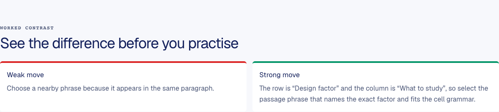
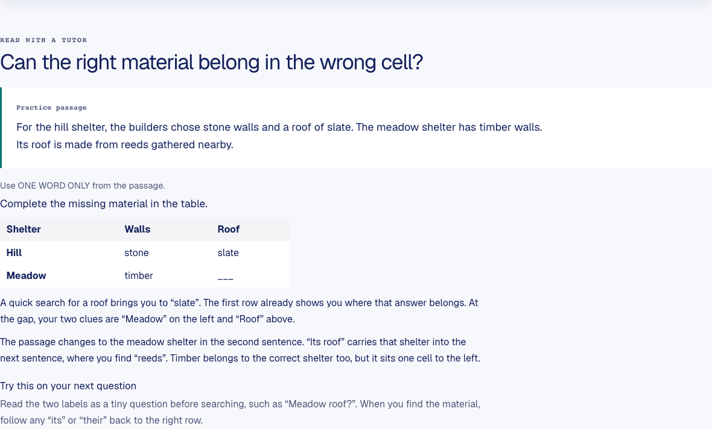
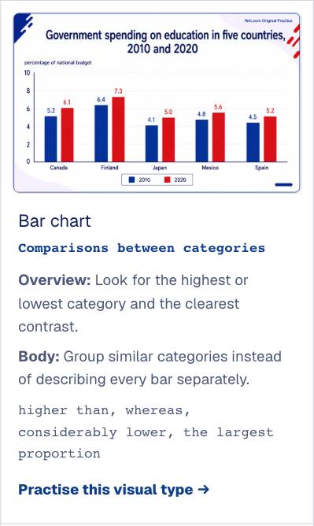
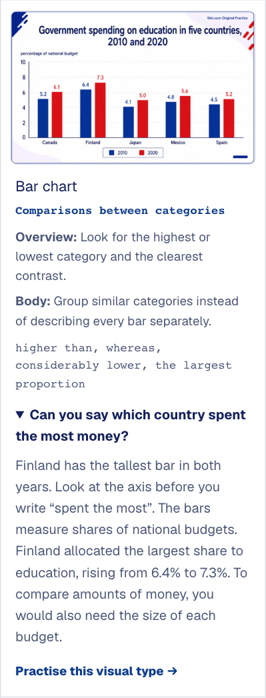
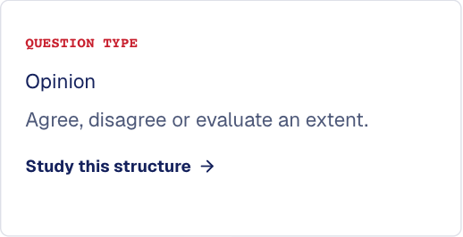
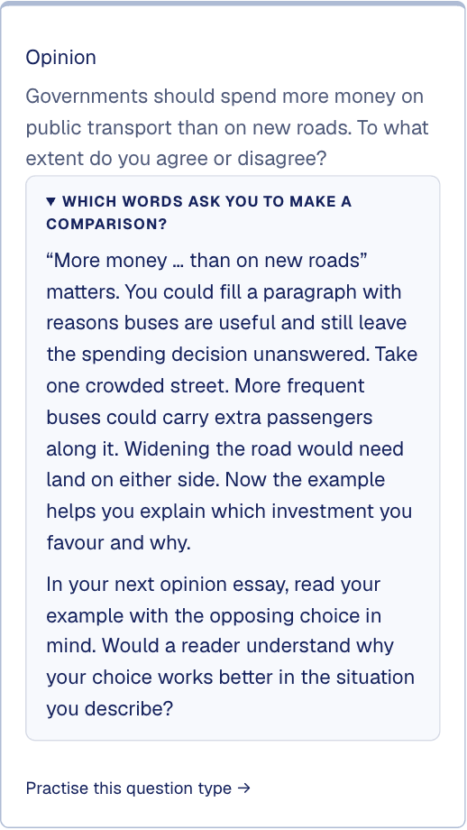
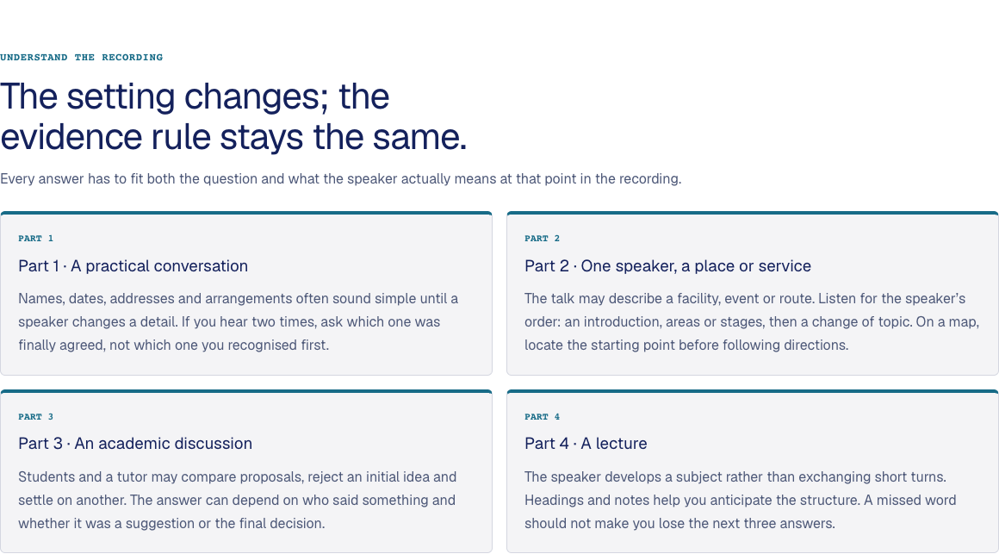
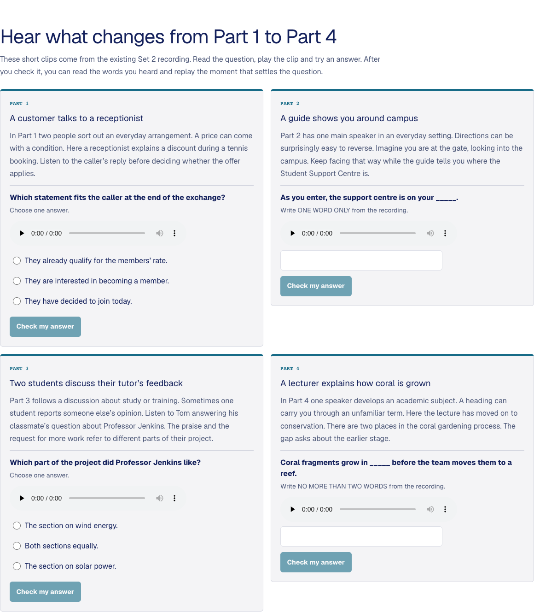
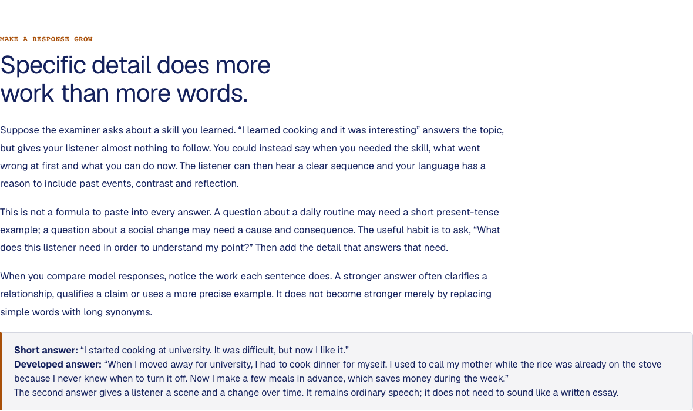
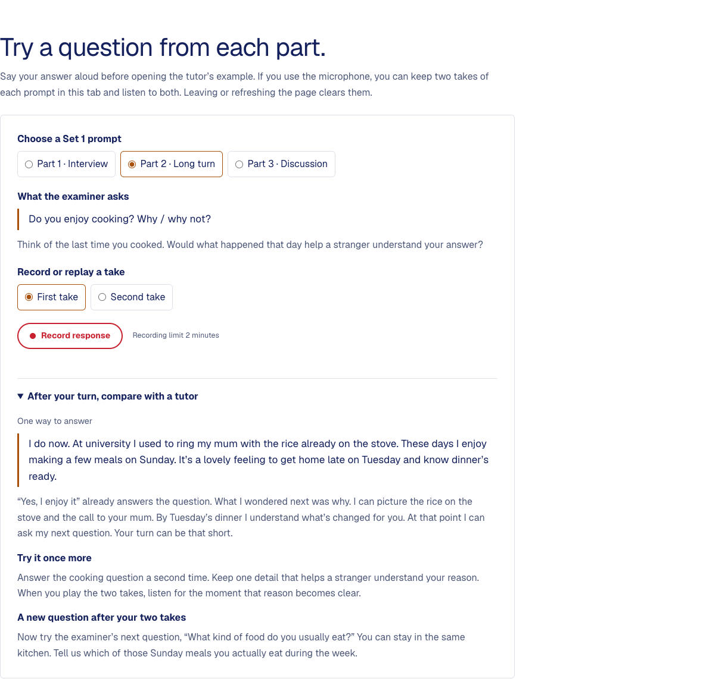

# IELTS Academic · revisión de las cuatro habilidades

Estas capturas muestran la aplicación funcionando antes y después de la revisión. Cada pareja corresponde a la misma lección. Puedes pulsar una imagen para leerla a su tamaño original.

| Lección | Antes | Después |
| --- | --- | --- |
| **Reading · completar una tabla.** El alumno sigue una fila y una columna hasta averiguar por qué un material que sí aparece en el pasaje puede quedar en la casilla equivocada. |  |  |
| **Writing Task 1 · comparar porcentajes.** ¿Quién destinó más dinero a educación? El gráfico da porcentajes. Para llegar a una cantidad también haría falta conocer cada presupuesto. |  |  |
| **Writing Task 2 · sostener una opinión.** Ante una decisión entre trenes y carreteras, el alumno prueba su argumento contra una dificultad concreta de la carretera. |  |  |
| **Listening · oír una decisión.** En Part 1, al cliente le interesa la tarifa de socios. Hay que escuchar su respuesta para saber si ya tiene derecho al descuento. Cada una de las cuatro partes tiene su propio fragmento y pregunta. |  |  |
| **Speaking · probar y volver a escuchar.** El alumno practica con una consigna del Set 1, puede grabar dos tomas de esa misma pregunta y comparar el detalle que eligió desarrollar. |  |  |

En Listening también puedes abrir la respuesta posterior al primer intento para ver cómo se explica una opción atractiva y cómo volver a escuchar. [Ver la corrección del descuento](listening-correccion.png).

En el simulacro guiado, la corrección enlaza con una lección y permite volver a la fuente completa. Estas dos capturas proceden del componente de corrección en una prueba aislada con los datos del Set 1. [Reading, respuesta y pasaje](simulacro-reading-correccion.png) · [Listening, respuesta y grabación](simulacro-listening-correccion.png).

En la hoja imprimible de Speaking, la última indicación de la tarjeta sobre la visita al trabajo quedaba sola al pasar la página. La consigna, sus tres viñetas y la indicación final ahora se pueden leer juntas. [Antes, página 1](speaking-tarjeta-antes-p1.png) · [Antes, página 2](speaking-tarjeta-antes-p2.png) · [Después, tarjeta completa](speaking-tarjeta-despues.png).

La muestra de tono de *skimming* conserva sus dos pares de capturas. El blueprint describe cómo dar explicaciones con la misma voz en Reading, Writing, Listening y Speaking. [Piloto de skimming](../ielts-skimming/README.md) · [Blueprint y controles de calidad](../../ielts-explanations-blueprint.md).

La comprobación editorial recorre las 21 lecciones de Reading, las siete familias visuales de Task 1, las cinco familias de Task 2, los cuatro fragmentos de Listening y las tres partes de Speaking. También prueba qué ocurre al bloquear el micrófono. Los expedientes de publicación de los simulacros tienen su propio informe. [Consultar el estado de los 20 sets guiados](../../ielts-harness.md).

Los sets 2 y 4 también tienen capturas de la experiencia completa de un alumno. Se ve la gráfica de Writing en móvil, qué se envía al terminar, el marcador y el intento guardado. [Ver el recorrido y los puntajes de los sets 2 y 4](./recorrido-alumno/README.md).
