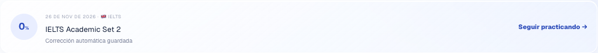
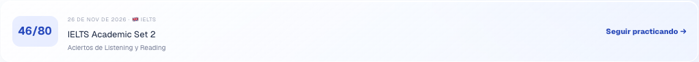
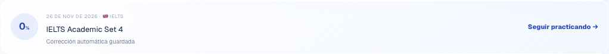
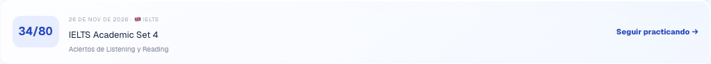

# Prueba con cuenta de alumno de IELTS Academic

El mismo alumno de pruebas completó los sets 2 y 4 en Chrome de escritorio y en una ventana táctil con ancho de móvil. La cuenta se registró y confirmó su correo en una instalación local de Supabase. Obtuvo IELTS como su examen gratuito a través de WeLearn. En cada intento, el alumno contestó las 40 preguntas de Listening y las 40 de Reading, escribió ambos textos, reprodujo una grabación de prueba y entregó las tres partes de Speaking.

| Set | Gráfica en móvil | Antes de entregar, escritorio | Marcador en móvil | Intento guardado |
| --- | --- | --- | --- | --- |
| 2 | [Ventas de videojuegos](set-2-390-writing-grafico.png) | [Los dos textos y los tres audios](set-2-1440-resumen.png) | [46/80](set-2-390-resultado.png) | [Mis intentos](set-2-1440-historial.png) |
| 4 | [Consumo de pescado y carne](set-4-390-writing-grafico.png) | [Los dos textos y los tres audios](set-4-1440-resumen.png) | [34/80](set-4-390-resultado.png) | [Mis intentos](set-4-1440-historial.png) |

Se introdujeron respuestas con aciertos y errores previstos para comprobar el cálculo del marcador. Al recargar se recuperaron las respuestas objetivas y los dos textos, y se mantuvo la hora límite. Las muestras de voz sintética pasaron por el grabador del navegador en tiempo real. Se contrastó el identificador de cada recibo con el registro de entrega, los dos puntajes y el tamaño de los tres archivos guardados en Storage privado. La franja gris de algunas capturas cubre el menú de la cuenta de prueba.

También se revisó qué puede deducir el alumno del material que tiene delante. En **Reading 8 del Set 2**, el fuego explica por qué se trasladaron los hornos a Murano. Mantener vigilados a los artesanos fue una ventaja secundaria. En **Reading 1 del Set 4** el pasaje habla de agricultores de subsistencia y la pregunta anterior decía «primeros agricultores». La revisión conserva los mismos dos grupos a ambos lados de la comparación. Así, *more hours* en la pregunta contradice *fewer hours* en el texto y permite decidir **False** sin recurrir a conocimientos de historia. [Pregunta revisada del Set 4](set-4-1440-reading-pregunta-1.png) · [Qué explicación ve el alumno si elige True](set-4-reading-1-explicacion.png) · [Solución independiente y evidencia del pasaje](../../../../config/ielts-harness/academic-reviews/set-4-reading-1-2026-11-26.json).

En la primera revisión, el Set 2 mostraba 46/80 al entregar, pero aparecía como 0 % al volver al historial. La banda final de IELTS seguía pendiente. Ahora el historial conserva la fracción de aciertos de Listening y Reading mientras se evalúan Writing y Speaking. Estas son las tarjetas que vio el alumno.

| Simulacro | Historial anterior | Historial corregido |
| --- | --- | --- |
| Set 2 |  |  |
| Set 4 |  |  |

Durante la prueba también se corrigieron tres pasos que podían interrumpir la entrega. Confirmar el correo ahora devuelve al simulacro solicitado, un teléfono internacional con espacios pasa la validación del formulario, y el alumno gratuito puede ver el marcador que calculó el servidor.

La prueba de estas pantallas corresponde al acceso gratuito y a la rama de revisión. [Evidencia de los cuatro recorridos](../../../../config/ielts-harness/ux-runtime-sets-2-4-2026-11-26.json) · [Qué revisar para aprobar el Set 1](../../../ielts-set-1-revision-del-titular.md)
