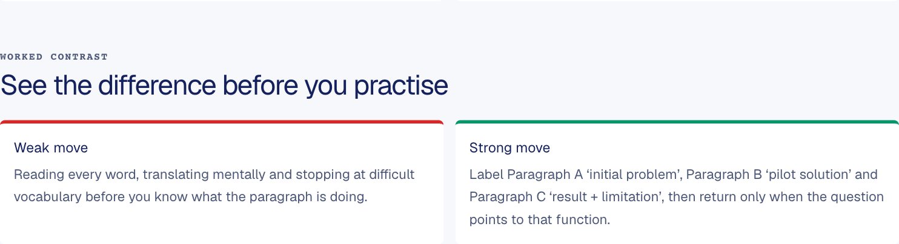
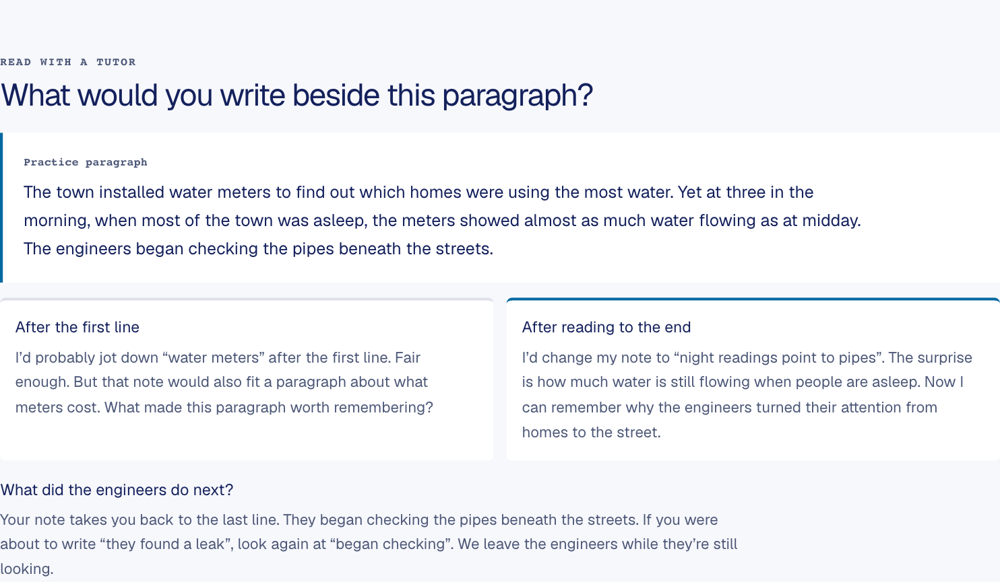
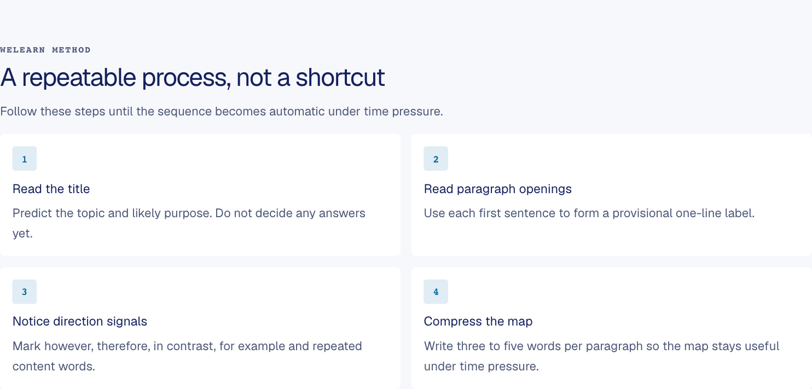
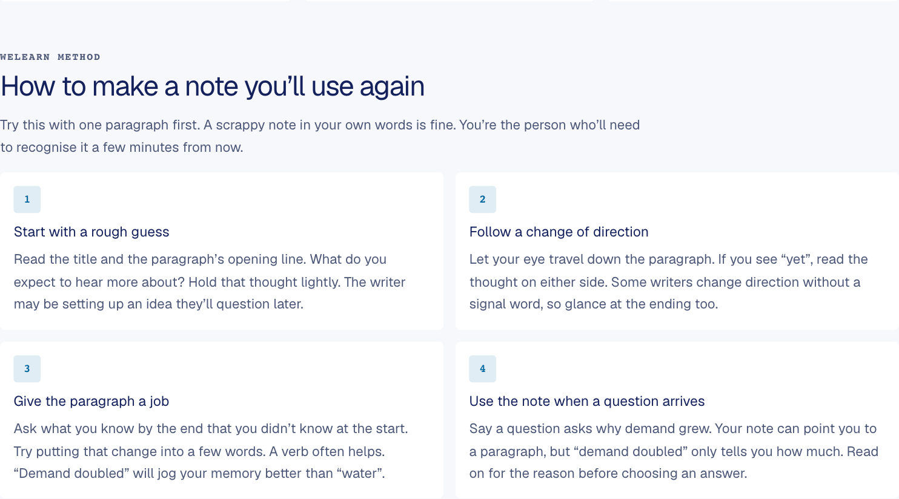

# IELTS Reading · Skimming

Esta muestra enseña a tomar una nota al leer un párrafo y a usarla después para comprobar una respuesta. Las cuatro capturas se tomaron en la misma lección, con el mismo ancho de pantalla. Puedes abrir cada imagen para leerla a tamaño completo.

## El ejemplo

### Antes

El alumno recibía etiquetas como *pilot solution*, pero faltaba el párrafo que le permitiera entender de dónde salía esa nota.

### Después

Tras la primera frase, *water meters* parece una nota razonable. La tutora la revisa cuando ve cuánta agua sigue circulando de madrugada. Al final vuelve a *began checking* para comprobar qué hicieron los ingenieros y hasta dónde llega la evidencia.

## El método de lectura

### Antes

### Después

## Qué revisar del tono

La tutora dice *“I’d probably jot down ‘water meters’ after the first line”* y deja ver cómo cambia de opinión. ¿Suena como una explicación que querrías oír en clase? Para probar la estrategia por su cuenta, el alumno tiene después los pasajes de árboles y manglares que ya formaban parte de la lección.
